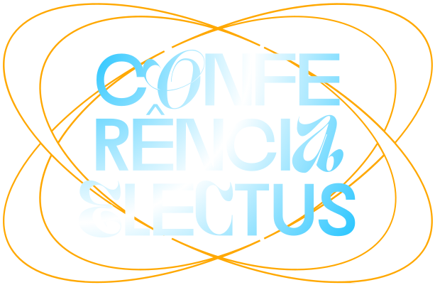
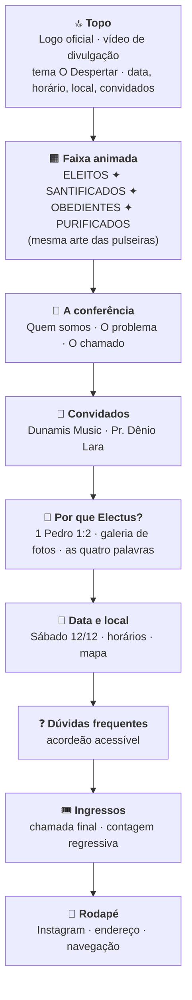
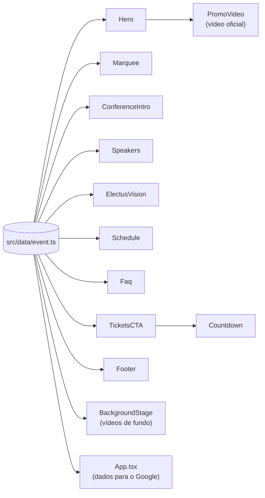
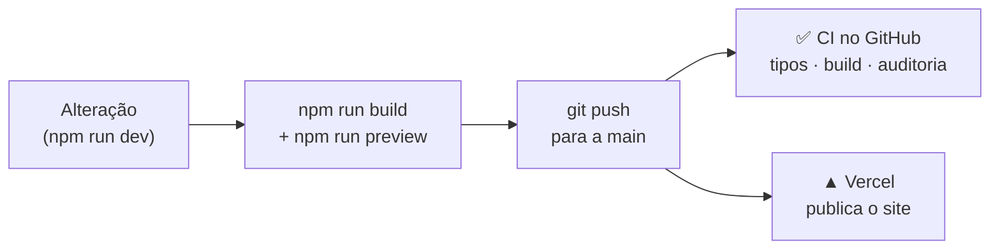

<div align="center">



# Conferência Electus 2026 · O Despertar

**Landing page oficial da conferência do Electus, o ministério de jovens da Cidade Renovo.**
[www.conferenciaelectus.com.br](https://www.conferenciaelectus.com.br)
Sábado, 12 de dezembro de 2026 · Cidade Renovo · São Bernardo do Campo, SP

[](https://github.com/luanviccs/Site_Conferencia_Electus/actions/workflows/ci.yml)


[Início rápido](#-início-rápido) ·
[Como editar](#%EF%B8%8F-como-editar-o-conteúdo) ·
[Estrutura](#-estrutura-do-projeto) ·
[Identidade visual](#-identidade-visual) ·
[Segurança](#-segurança) ·
[Publicação](#-publicação)

</div>

---

## 📌 O evento em um quadro

| | |
|---|---|
| **Tema** | O Despertar: *"Escolhidos por Deus, despertados pelo Espírito."* |
| **Data** | Sábado, 12 de dezembro de 2026 |
| **Horários** | 15h30, abertura dos portões · 16h30, início do evento |
| **Local** | Cidade Renovo, Estrada dos Casa, 4285, Bairro dos Casa, São Bernardo do Campo, SP (estacionamento gratuito) |
| **Convidados** | Dunamis Music · Pr. Dênio Lara |
| **Versículo** | 1 Pedro 1:2: eleitos, santificados, obedientes, purificados |
| **Ingressos** | [e-inscrição](https://www.e-inscricao.com/e/w9OD4Z000a8g) |
| **Instagram** | [@electus.sbc](https://instagram.com/electus.sbc) |

> [!TIP]
> **Todo o conteúdo do site** (datas, horários, textos, convidados, dúvidas, fotos, vídeos e link de compra) fica em um único arquivo:
> [`src/data/event.ts`](src/data/event.ts). Na maioria das mudanças, não é preciso mexer em mais nada.

---

## 🧭 A página, de cima para baixo

A ordem das seções foi pensada para a conversão: o que é → quem vem → identidade → quando e onde → dúvidas → compra.



Atrás de toda a página há um **palco de vídeos de fundo**: vídeos mudos e escurecidos que trocam com fusão suave conforme a seção visível.

| Seção na tela | Vídeo de fundo (`public/media/`) |
|---|---|
| Topo | `bg-ministracao` |
| A conferência | `bg-drone` (drone na Cidade Renovo) |
| Convidados | `bg-adoracao` |
| Por que Electus? | `bg-danca` |
| Data e local · Dúvidas | `bg-jesus` |
| Ingressos | `bg-louvor` |

---

## 🚀 Início rápido

Pré-requisito: **Node.js 20.19 ou superior** (recomendado: 22).

```bash
npm install
```

```bash
npm run dev
```

Abre em `http://localhost:5173`, com recarregamento automático a cada alteração.

| Comando | O que faz |
|---|---|
| `npm run dev` | Servidor de desenvolvimento com recarregamento ao vivo |
| `npm run typecheck` | Confere os tipos do TypeScript (modo estrito) |
| `npm run build` | Confere os tipos e gera o site final em `dist/` |
| `npm run preview` | Serve o `dist/` **com os mesmos cabeçalhos de segurança da produção**, para testar antes de publicar |

---

## ✏️ Como editar o conteúdo

Clique em cada item para ver o passo a passo. A referência completa de todos os campos está em [`docs/CONTEUDO.md`](docs/CONTEUDO.md).

<details>
<summary><b>🎟️ Trocar o link de compra de ingressos</b></summary>

1. Abra [`src/data/event.ts`](src/data/event.ts).
2. Troque a constante no topo do arquivo:
   ```ts
   export const TICKET_URL = "https://www.e-inscricao.com/e/w9OD4Z000a8g";
   ```
3. Pronto: **todos** os botões de ingresso (topo, menu, convidados, dúvidas, ingressos, rodapé) usam esse link.

</details>

<details>
<summary><b>🕓 Mudar data ou horários</b></summary>

Em `src/data/event.ts`:

- `dates`: datas e horas em formato ISO, usadas na contagem regressiva e nos dados para o Google.
  `doors` = abertura dos portões (alvo da contagem), `start` = início, `end` = fim (até quando a contagem mostra "É agora.").
- `day`: o dia exibido (`SÁBADO`, `12`, `DEZ`).
- `schedule`: a lista de horários exibida no topo e em "Data e local".

> [!NOTE]
> O horário de término (`end`, 23h) é uma estimativa. Confirme com a organização.

</details>

<details>
<summary><b>❓ Adicionar ou editar uma pergunta frequente</b></summary>

Em `src/data/event.ts`, na lista `faq`:

```ts
{ q: "Tem algum local para comer perto?",
  a: "Sim, o evento contará com praça de alimentação no local." },
```

Opcional: `link: { label: "Ver endereço", href: "#local" }` mostra um atalho, e `ticket: true` mostra o botão de ingresso abaixo da resposta.
As perguntas também viram dados estruturados (FAQ) para o Google automaticamente.

</details>

<details>
<summary><b>🎤 Editar um convidado</b></summary>

Em `src/data/event.ts`, na lista `speakers`: `name`, `description` (texto oficial do card de divulgação), `instagram`,
`image` (arquivo em `public/images/speakers/`), `w`/`h` (dimensões reais da foto), `pos` (enquadramento, ex.: `"50% 36%"`).

No site, os convidados aparecem um por linha, alternando os lados (foto à esquerda e texto à direita, depois o inverso).

</details>

<details>
<summary><b>🖼️ Trocar as fotos da galeria</b></summary>

1. Gere duas versões de cada foto em `public/images/electus/`: `nome.webp` (1800px de largura) e `nome-960.webp` (960px, para celulares).
2. Atualize a lista `photos` em `src/data/event.ts` com `src`, `pos` (enquadramento) e `alt` (descrição para leitores de tela).
3. A ordem da lista define a posição no mosaico (a 1ª é a foto grande).

Receitas de conversão: [`docs/MIDIA.md`](docs/MIDIA.md).

</details>

<details>
<summary><b>🎬 Trocar o vídeo oficial de divulgação</b></summary>

O vídeo toca no próprio site, logo abaixo do logo: prévia sem som enquanto está na tela e som ao primeiro toque.

1. Gere `promo-electus.mp4` (720p), `promo-electus-540.mp4` (celular) e `promo-electus.webp` (capa) em `public/media/`.
2. Se mudar os nomes, ajuste `promoVideo` em `src/data/event.ts`.

Se o arquivo faltar, o site mostra automaticamente o Reel incorporado do Instagram no mesmo lugar.
Receitas de conversão: [`docs/MIDIA.md`](docs/MIDIA.md).

</details>

---

## 🗂️ Estrutura do projeto

```text
electus/
├── index.html                 # metatags (título, descrição, compartilhamento) e fontes do Google
├── vercel.json                # cabeçalhos de segurança e cache da produção
├── vite.config.ts             # build; o preview usa os mesmos cabeçalhos do vercel.json
├── src/
│   ├── data/event.ts          # ⭐ ÚNICA FONTE DE CONTEÚDO do site
│   ├── App.tsx                # ordem das seções + dados estruturados (Event e FAQPage)
│   ├── index.css              # tema (cores, fontes), componentes de texto/botão, animações
│   ├── hooks/                 # useCountdown (contagem), useMedia (media queries)
│   └── components/            # uma seção por arquivo (Hero, Speakers, Schedule, Faq…)
├── public/
│   ├── logo/                  # logo oficial (SVG otimizado), letra "e", favicon
│   ├── fonts/                 # fonte pixel Our Arcade Games (com acentos acrescentados)
│   ├── images/electus/        # fotos da galeria (+ versões -960) e og.jpg (compartilhamento)
│   ├── images/speakers/       # fotos dos convidados
│   └── media/                 # vídeos de fundo (h = desktop, v = celular) e vídeo oficial
├── scripts/                   # geração da fonte pixel e otimização do logo (Python)
├── automacao/relatorio-semanal/ # relatório semanal por e-mail (Python + GitHub Actions; fora do site)
├── docs/                      # documentação detalhada
├── fotos-antigas/             # arquivo: fotos anteriores, fora do site
└── .github/workflows/ci.yml   # verificação automática a cada envio
```

Como os dados chegam às seções:



Detalhes de cada componente e decisões técnicas: [`docs/ARQUITETURA.md`](docs/ARQUITETURA.md).

---

## 🎨 Identidade visual

**Cores oficiais** (únicas cores de destaque, sobre fundo preto uniforme):

| Cor | Código | Uso |
|---|---|---|
|  | `#FFA800` laranja | botões, destaques, rótulos, faixa animada |
|  | `#18C1FF` azul | degradê dos títulos, contagem, painel do local, brilhos |
|  | `#FFFFFF` branco | textos e títulos |
|  | `#000000` preto | fundo |

Definidas como tokens em [`src/index.css`](src/index.css) (`--color-orange`, `--color-blue`/`--color-sky`, `--color-paper`, `--color-ink`).

**Fontes:**

| Fonte | Onde | Origem |
|---|---|---|
| Big Shoulders Display | títulos e subtítulos | Google Fonts |
| Instrument Sans | textos | Google Fonts |
| Our Arcade Games (pixel) | "O DESPERTAR", faixa animada, descrição dos convidados | `public/fonts/` (classe `font-pixel`) |

> [!IMPORTANT]
> O arquivo original da fonte pixel só tinha letras sem acento e números. Acentos, pontuação, `@`, setas, `✦` e parênteses
> foram desenhados no mesmo grid de pixels por [`scripts/fonte-pixel.py`](scripts/fonte-pixel.py).
> Se um texto nessa fonte usar um caractere novo, acrescente-o no script. Do contrário, ele aparece em outra fonte.

---

## 🔒 Segurança

- **Cabeçalhos HTTP** na produção ([`vercel.json`](vercel.json)): Content-Security-Policy restritiva, `X-Frame-Options: DENY`,
  `X-Content-Type-Options: nosniff`, `Referrer-Policy`, `Permissions-Policy` e `Cross-Origin-Opener-Policy`.
- **Sem segredos** no código: o site é 100% estático, sem formulários, cookies próprios nem chaves de API.
- **Links externos** abrem em nova aba sempre com `rel="noopener noreferrer"`.
- **Scripts de terceiros:** só o do Instagram, e apenas se o vídeo oficial não carregar.
- **CI** audita as dependências a cada envio.

Política completa e como reportar um problema: [`SECURITY.md`](SECURITY.md).

---

## ⚡ Desempenho e acessibilidade

- Vídeos de fundo só baixam quando vão tocar; com **movimento reduzido** ou **economia de dados** ficam só as imagens estáticas.
- O vídeo oficial usa 720p no desktop e 540p no celular e pausa fora da tela.
- Fotos com versão de 960px para celulares, carregamento sob demanda e enquadramento por foto.
- Logo oficial otimizado de 6 MB para 374 KB, sem perda (diferença de 0 pixel).
- Navegação por teclado, foco visível, link "Ir para o conteúdo", acordeão com `aria-expanded`, textos alternativos em todas as fotos.
- Animações desligadas com `prefers-reduced-motion`.

---

## 🌐 Publicação



- **Hospedagem:** Vercel, configurada por [`vercel.json`](vercel.json) (build `npm run build`, saída `dist/`).
- **Fluxo:** cada alteração concluída e conferida vai direto para a `main`; o CI confere tipos, build e dependências.

---

## 📋 Pendências conhecidas

- [x] **Domínio definitivo:** `https://www.conferenciaelectus.com.br` (endereço canônico e prévia de compartilhamento em `index.html`).
- [ ] **Horário de término:** confirmar com a organização (`dates.end`, hoje 23h).
- [ ] **Licença:** definir a licença do código, se o repositório for público.

---

## 📚 Documentação

| Documento | Conteúdo |
|---|---|
| [`docs/CONTEUDO.md`](docs/CONTEUDO.md) | Referência de todos os campos do `event.ts` |
| [`docs/ARQUITETURA.md`](docs/ARQUITETURA.md) | Componentes, vídeos de fundo, player, estilos e decisões técnicas |
| [`docs/MIDIA.md`](docs/MIDIA.md) | Especificações e receitas para vídeos, fotos, logo e fonte |
| [`SECURITY.md`](SECURITY.md) | Política de segurança e cabeçalhos |
| [`automacao/relatorio-semanal/`](automacao/relatorio-semanal/README.md) | Relatório semanal de acessos, cliques e vendas por e-mail, toda segunda (configuração passo a passo) |
| [`CHANGELOG.md`](CHANGELOG.md) | Histórico de mudanças |

<div align="center">
<sub>Electus · Cidade Renovo · São Bernardo do Campo, SP</sub>
</div>
