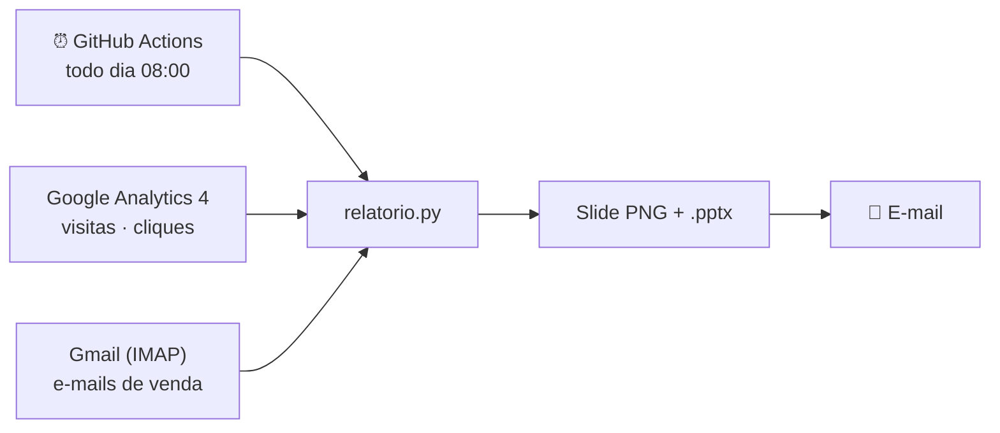
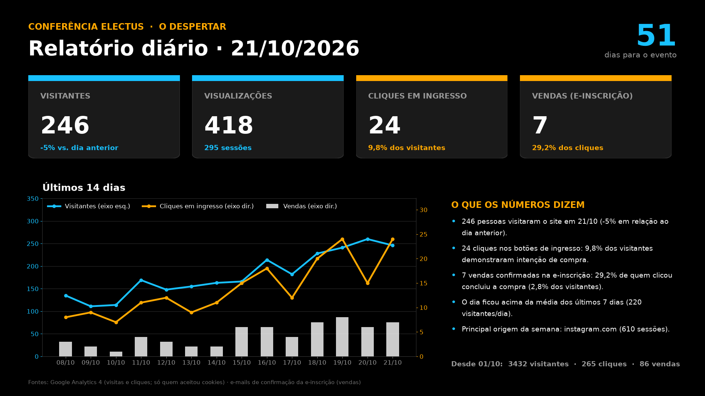

# 📊 Relatório diário da Conferência Electus

Todo dia às **08:00 (Brasília)**, o GitHub roda [`relatorio.py`](relatorio.py) na nuvem, mesmo com o computador desligado:

1. lê no **Google Analytics 4** os visitantes, visualizações e cliques nos botões de ingresso do dia anterior (e dos últimos 14 dias);
2. conta as **vendas** pelos e-mails de confirmação da e-inscrição que chegam no Gmail;
3. gera **um slide** (PNG 1920×1080 + PowerPoint) com gráfico, indicadores e a explicação dos números;
4. envia por **e-mail**, com o slide no corpo e em anexo.

[← voltar ao README do projeto](../../README.md)



Exemplo do slide (**dados fictícios** de demonstração, gerados com `python relatorio.py --demo`):



| Indicador | O que significa |
|---|---|
| **Visitantes** | Pessoas diferentes que abriram o site no dia (variação contra o dia anterior) |
| **Visualizações / sessões** | Páginas vistas e visitas (uma pessoa pode visitar mais de uma vez) |
| **Cliques em ingresso** | Cliques em qualquer botão "Garanta seu ingresso" (intenção de compra); % sobre visitantes |
| **Vendas** | E-mails de confirmação de compra recebidos; % sobre cliques (quem clicou e comprou) |

> [!NOTE]
> O Google Analytics só mede quem **aceita os cookies** no aviso do site (exigência da LGPD), então os números são um
> pouco menores que o total real de visitas. As vendas vêm dos e-mails e não têm essa limitação.

---

## ⚙️ Configuração (uma vez só, ~20 minutos)

Nada roda até estes passos estarem feitos; enquanto isso, a execução diária só avisa o que falta, sem erro.

<details>
<summary><b>1. Criar o Google Analytics 4 e ligar no site</b></summary>

1. Em [analytics.google.com](https://analytics.google.com), crie uma conta e uma **propriedade** "Conferência Electus"
   (fuso horário: São Paulo; moeda: Real).
2. Crie um **fluxo de dados da Web** com o endereço `https://www.conferenciaelectus.com.br`.
3. Copie o **ID de medição** (começa com `G-`) e coloque em `src/data/event.ts`:
   ```ts
   analytics: { ga4Id: "G-XXXXXXXXXX" },
   ```
   Publique (commit na `main`). A partir daí o site mostra o aviso de cookies e passa a medir.
4. Anote também o **ID da propriedade** (só números), em Administrador → Detalhes da propriedade.

</details>

<details>
<summary><b>2. Criar a chave de leitura do Analytics (conta de serviço)</b></summary>

1. Em [console.cloud.google.com](https://console.cloud.google.com), crie um projeto (ex.: `electus-relatorio`).
2. Ative a API **Google Analytics Data API**.
3. Em IAM → **Contas de serviço**, crie uma conta (ex.: `relatorio`) e gere uma **chave JSON** (baixa um arquivo `.json`).
4. No Google Analytics → Administrador → **Gerenciamento de acesso à propriedade**, adicione o e-mail da conta de serviço
   (termina em `iam.gserviceaccount.com`) com o papel **Leitor**.

> [!CAUTION]
> O arquivo `.json` é uma senha. Nunca coloque no repositório; ele vai só nos *Secrets* do GitHub (passo 4).

</details>

<details>
<summary><b>3. Criar a senha de app do Gmail</b></summary>

1. A conta Google precisa ter a **verificação em duas etapas** ativada.
2. Em [myaccount.google.com/apppasswords](https://myaccount.google.com/apppasswords), crie uma senha de app chamada
   `Relatório Electus`. Ela tem 16 letras e serve só para este envio; dá para revogar quando quiser.
3. **Vendas:** use o Gmail que **recebe os avisos de compra da e-inscrição**. Abra um desses e-mails e anote o remetente
   (ex.: `e-inscricao.com`) e um trecho fixo do assunto (ex.: `Nova inscrição`).

</details>

<details>
<summary><b>4. Guardar tudo no GitHub (Secrets e Variables)</b></summary>

No repositório: **Settings → Secrets and variables → Actions**.

**Secrets** (aba *Secrets*, "New repository secret"):

| Nome | Valor |
|---|---|
| `GA4_PROPERTY_ID` | ID numérico da propriedade (passo 1.4) |
| `GA4_CREDENTIALS_JSON` | conteúdo inteiro do arquivo `.json` da conta de serviço (passo 2.3) |
| `GMAIL_USER` | o Gmail que envia (e recebe os avisos de venda) |
| `GMAIL_APP_PASSWORD` | a senha de app de 16 letras (passo 3.2) |
| `RELATORIO_PARA` | quem recebe o relatório (vários: separe por vírgula) |

**Variables** (aba *Variables*), para contar as vendas (opcionais):

| Nome | Exemplo |
|---|---|
| `VENDAS_REMETENTE` | `e-inscricao.com` |
| `VENDAS_ASSUNTO` | `Nova inscrição` |

Sem essas duas, o slide mostra "Vendas: não configurado" e o resto funciona normalmente.

</details>

<details>
<summary><b>5. Testar</b></summary>

Em **Actions → Relatório diário → Run workflow** (pode informar um dia, ex.: `2026-10-21`). Em 1–2 minutos o e-mail chega;
o slide também fica para download na própria execução (aba *Artifacts*, por 14 dias).

</details>

---

## 🧪 Rodar no computador

```bash
pip install -r requirements.txt
```

```bash
python relatorio.py --demo
```

Gera o slide com dados de exemplo em `saida/` (pasta ignorada pelo git). Com as variáveis de ambiente da tabela acima
definidas, `python relatorio.py --sem-email` gera com os dados reais sem enviar, e `python relatorio.py` envia.

## 🔧 Ajustes comuns

| O quê | Onde (em `relatorio.py`) |
|---|---|
| Data do evento (contagem "dias para o evento") | `EVENTO` |
| Início da contagem acumulada | `INICIO_CAMPANHA` |
| Quantos dias no gráfico | `DIAS_GRAFICO` |
| Horário do envio | `cron` em [`.github/workflows/relatorio-diario.yml`](../../.github/workflows/relatorio-diario.yml) (UTC: 11:00 = 08:00 em Brasília) |
| Nome do evento de clique | `EVENTO_CLIQUE` (precisa bater com `src/components/TicketButton.tsx`) |

## 🔒 Segurança

- Senhas e chaves ficam **só** nos Secrets do GitHub; o código não guarda nenhuma.
- O acesso ao Analytics é **somente leitura**; o acesso ao Gmail só **lê cabeçalhos** (data e assunto) dos avisos de venda,
  em modo somente leitura, e envia o relatório.
- Esta pasta não faz parte do site: está no `.vercelignore` e não entra no build nem na publicação.
