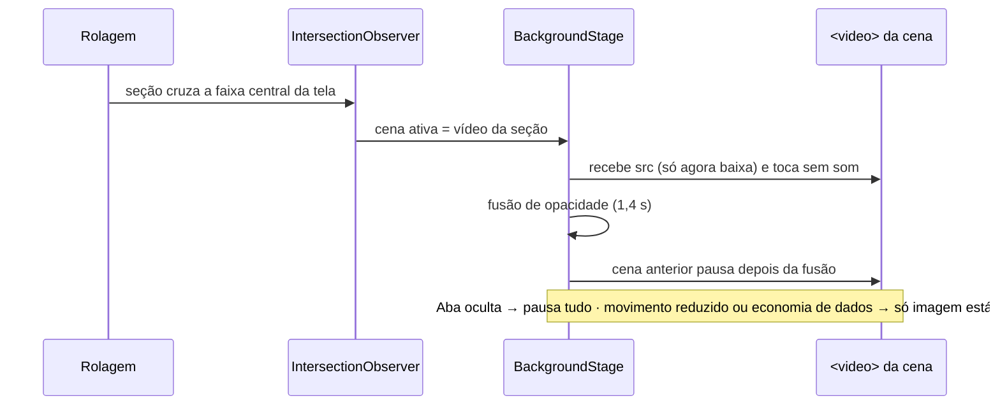
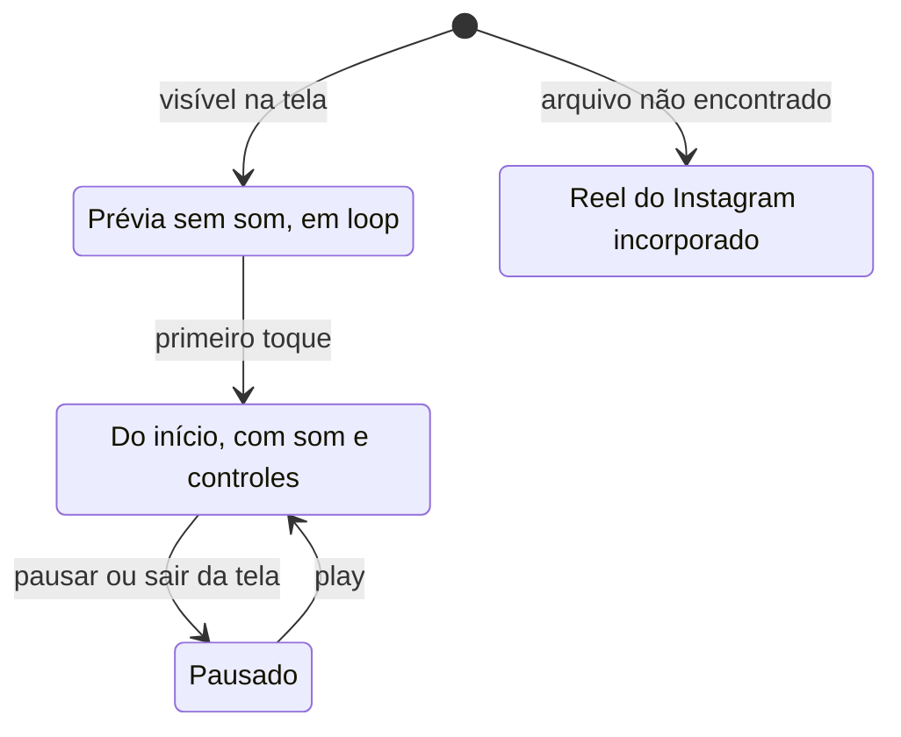

# Arquitetura

Site estático de uma página: **React 18 + TypeScript (estrito) + Vite 7 + Tailwind CSS 4**, publicado na Vercel.
Não tem servidor, banco de dados, formulário nem login: tudo é gerado no build e servido como arquivos.

[← voltar ao README](../README.md)

---

## Princípios

1. **Uma fonte de conteúdo:** [`src/data/event.ts`](../src/data/event.ts). Os componentes não têm texto fixo de conteúdo.
2. **Um componente por seção**, na ordem definida em [`src/App.tsx`](../src/App.tsx).
3. **Identidade em tokens:** cores e fontes ficam no `@theme` de [`src/index.css`](../src/index.css); os componentes usam
   as classes geradas (`text-orange`, `bg-blue`, `font-display`, `font-pixel`…).
4. **Leve por padrão:** mídia só baixa quando vai aparecer, com versões menores para celular.
5. **Acessível:** semântica HTML, foco visível, `aria-*` nos controles e respeito a `prefers-reduced-motion`.

## Componentes

| Arquivo | Papel |
|---|---|
| `App.tsx` | Ordem das seções; injeta os dados estruturados `Event` e `FAQPage` (JSON-LD) para o Google |
| `BackgroundStage.tsx` | Palco fixo de vídeos de fundo que trocam com fusão conforme a seção visível |
| `Header.tsx` | Cabeçalho fixo (transparente no topo, sólido ao rolar), menu do celular |
| `Hero.tsx` | Logo oficial, vídeo oficial, tema, data/horário/local/convidados, botões |
| `PromoVideo.tsx` | Player próprio do vídeo oficial (prévia sem som, som no primeiro toque, controles, reserva do Instagram) |
| `Marquee.tsx` | Faixa laranja animada com as quatro palavras (fonte pixel) |
| `ConferenceIntro.tsx` | "A conferência": título, frase e três blocos |
| `Speakers.tsx` | Convidados, um por linha, alternando os lados |
| `ElectusVision.tsx` | "Por que Electus?": versículo, galeria em mosaico, quatro palavras, frase do tema |
| `Schedule.tsx` | "Data e local": dia, horários e painel do local |
| `Faq.tsx` | Dúvidas frequentes em acordeão acessível |
| `TicketsCTA.tsx` + `Countdown.tsx` | Chamada final e contagem regressiva até a abertura dos portões |
| `Footer.tsx` | Instagram, endereço, navegação, wordmark |
| `TicketButton.tsx` | Botão único de compra (todos os CTAs usam ele) |
| `Photo.tsx`, `Reveal.tsx`, `Sparkle.tsx`, `Mark.tsx` | Foto com entrada animada, entrada ao rolar, brilho de 4 pontas, letra "e" como máscara |

Hooks: `useCountdown` (dias/horas/min/seg e estado antes/ao vivo/depois) e `useMedia` (media queries reativas).

## Vídeos de fundo (`BackgroundStage`)

- Versão `-h` (horizontal) a partir de 768px e `-v` (vertical) no celular.
- O tom azul e o desfoque já vêm no arquivo: nada de filtro CSS por quadro, o que economiza processamento.

## Vídeo oficial (`PromoVideo`)

- 720p (`src`) a partir de 768px, 540p (`srcMobile`) no celular.
- Movimento reduzido ou economia de dados: sem prévia automática, só a capa até o play.
- Aba em segundo plano: a prévia recomeça ao voltar, se o vídeo estiver na tela.
- O script do Instagram só é carregado na reserva.

## Estilos

- **Tokens** em `@theme` (`src/index.css`): `--color-orange` `#FFA800`, `--color-blue`/`--color-sky` `#18C1FF`,
  `--color-paper` `#FFFFFF`, `--color-ink` `#000000`.
- **Componentes de texto:** `.eyebrow` (rótulo com traço; `.eyebrow-center` espelha o traço), `.h-section` (título com
  degradê branco → azul), `.lede` (texto de apoio), `.label` (rótulo de dado).
- **Botões:** `.btn` + `.btn-primary` / `.btn-ghost` / `.btn-sm` / `.btn-lg`.
- **Movimento:** `.rise` (entrada do topo), `.reveal`/`.reveal-photo` (entrada ao rolar), `.marquee` (faixa); tudo desligado
  com `prefers-reduced-motion`.

## Fontes

| Token | Fonte | Observação |
|---|---|---|
| `--font-display`, `--font-cond` | Big Shoulders Display | Títulos e rótulos |
| `--font-sans` | Instrument Sans | Textos |
| `--font-pixel` | Our Arcade Games | `size-adjust: 70%` para casar a altura das maiúsculas; peso único, sem negrito sintético |

A fonte pixel recebeu acentos e pontuação por [`scripts/fonte-pixel.py`](../scripts/fonte-pixel.py) (ver [MIDIA.md](MIDIA.md#fonte-pixel)).

## SEO e compartilhamento

- `index.html`: título, descrição, Open Graph (`og.jpg` 1200×630), cor do tema.
- `App.tsx`: JSON-LD `Event` (nome, datas, abertura dos portões, local, convidados, organizador, link) e `FAQPage`.

## Segurança

Cabeçalhos definidos em [`vercel.json`](../vercel.json) e aplicados também no `npm run preview` (via `vite.config.ts`).
Detalhes em [`SECURITY.md`](../SECURITY.md).

## Qualidade

- **TypeScript estrito** com `noUnusedLocals`.
- **CI** ([`.github/workflows/ci.yml`](../.github/workflows/ci.yml)): `npm ci` → `typecheck` → `build` → `npm audit --omit=dev`.
- **Finais de linha** normalizados (LF) por `.gitattributes`.
